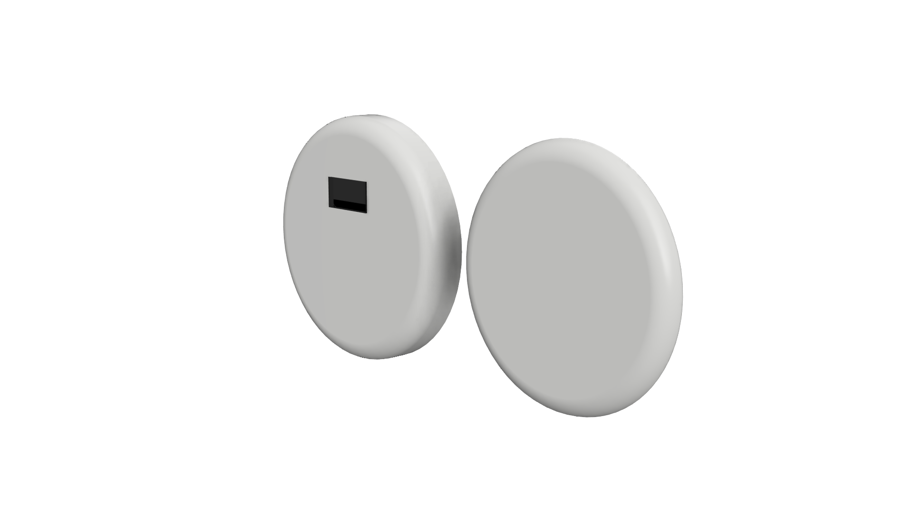
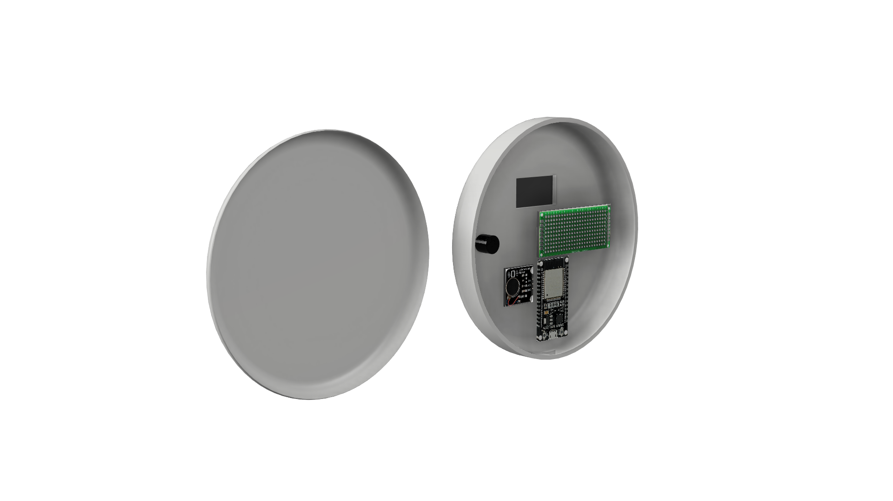

# Vistas del diseño 3D

Las imágenes muestran una versión circular de la carcasa y una distribución referencial de componentes en su interior. Los [planos de las tapas](../planos/README.md) presentan la versión ovalada posterior.

## Vista exterior

[Abrir imagen exterior](01_isometrica_frontal.png)

## Vista interior

[Abrir imagen interior](02_isometrica_trasera.png)

El modelo editable y los planos se encuentran en [Fusion 360](../fusion360/README.md) y [planos](../planos/README.md).
