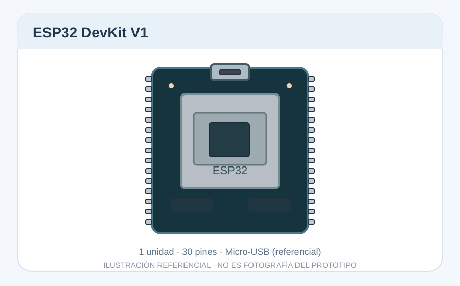
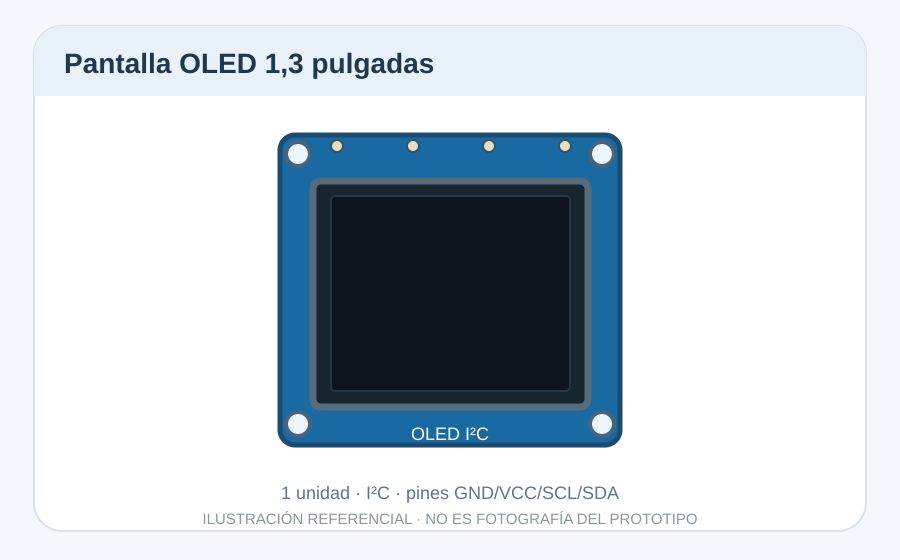
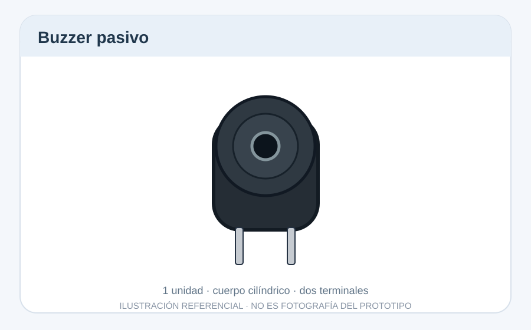
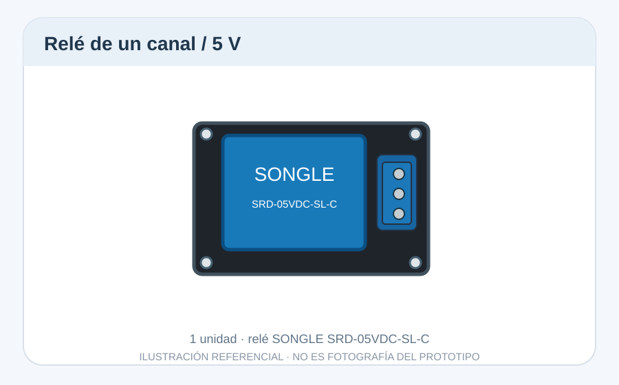
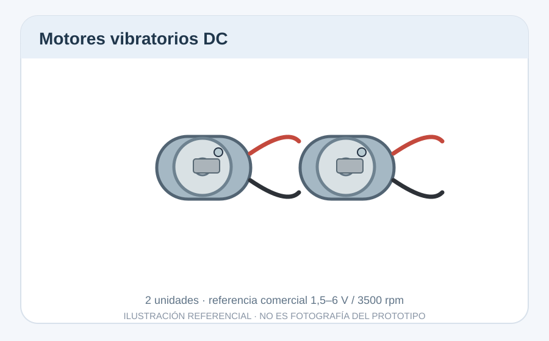
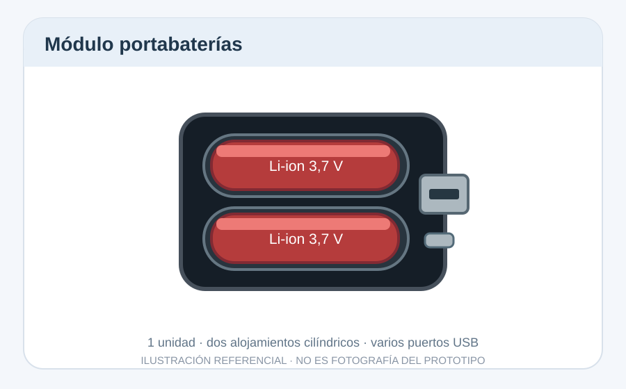
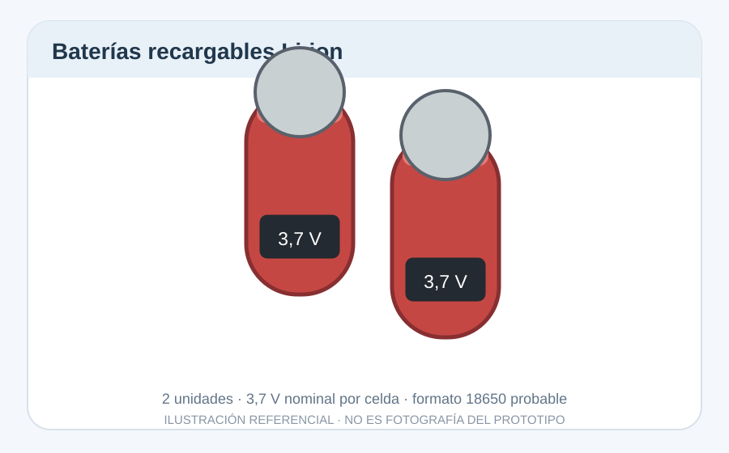
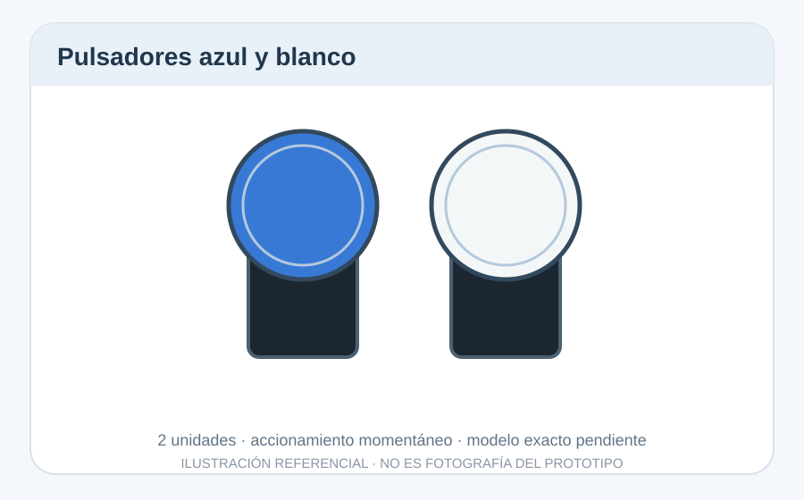
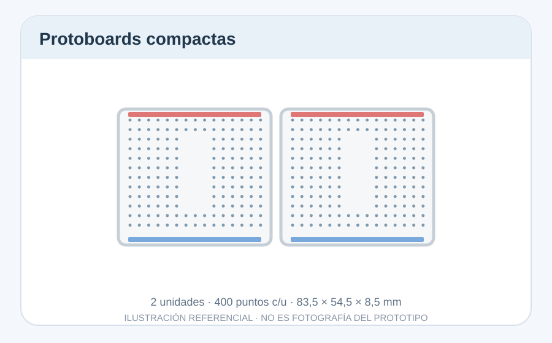
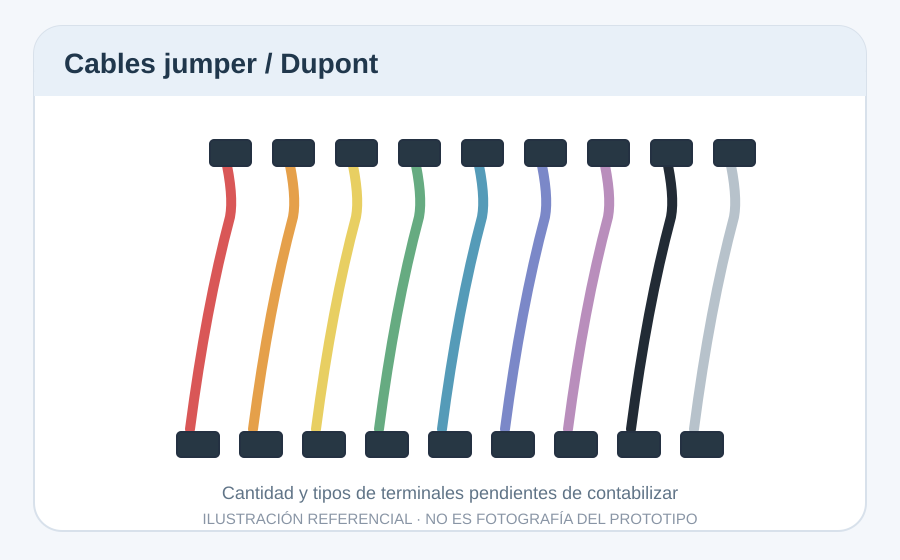

# Catálogo ilustrado de componentes electrónicos

**Proyecto:** alarma accesible para personas sordas o con dificultades auditivas (TEI201, UAI).  
**Estado:** documentación técnica preliminar revisada el 22 de noviembre de 2026.  
**Criterio de evidencia:** fotografías reales y descripciones del equipo; los datos de fichas comerciales se distinguen de mediciones experimentales. Una característica no comprobada se marca como **pendiente de verificar**.

> **Cómo leer las imágenes:** son **ilustraciones genéricas originales**, elaboradas con asistencia de IA para identificar la clase de dispositivo; **no son fotografías de las unidades reales, ni aseguran la marca, geometría o pines exactos**. Las fotos reales se documentan por separado en [fotos/](fotos/).

## 1. Microcontrolador ESP32 DevKit V1

- **Cantidad:** 1 unidad.
- **Identificación proporcionada:** ESP32 DevKit V1, 30 pines (dos hileras de 15), con Micro-USB.
- **Características de la familia ESP32:** Wi-Fi de 2,4 GHz (802.11 b/g/n), Bluetooth clásico y BLE según módulo, procesador de hasta 240 MHz en variantes ESP32-WROOM-32, periféricos GPIO, I²C, SPI, UART y PWM; **GPIO de lógica a 3,3 V**.
- **Elementos visibles de la placa:** puerto de programación/alimentación, regulador, pines y módulo con antena integrada.
- **Por confirmar en la unidad:** modelo exacto del módulo (WROOM-32 o variante), capacidad flash, chip USB-serie, dimensiones y consumo.
- **Función:** gestionar las alarmas, la interfaz web local, la pantalla, el buzzer, el relé y el botón de detención.
- **Justificación:** permite configurar el dispositivo desde un teléfono mediante Wi-Fi sin exigir un servidor externo para esa interfaz, y dispone de periféricos para los actuadores.
- **Referencia técnica:** [Espressif ESP32-WROOM-32](https://www.espressif.com/sites/default/files/documentation/esp32-wroom-32_datasheet_en.pdf).

## 2. Pantalla OLED I²C de 1,3 pulgadas

- **Cantidad:** 1 unidad.
- **Confirmado visualmente:** PCB azul marcada `1.3' OLED IIC`, cuatro pines rotulados `GND`, `VCC`, `SCL`, `SDA`, cuatro orificios de montaje y selector `ADD_SELECT`.
- **Dirección I²C indicada en la placa:** `0x78` o `0x7A` en notación de 8 bits; equivalen a `0x3C` y `0x3D` en direccionamiento de 7 bits.
- **Probable, no confirmado por número de parte:** resolución 128 × 64 píxeles, controlador SH1106, pantalla monocromática.
- **Por verificar:** tensión admitida por el módulo concreto, corriente, posición exacta de zona visible y distancias entre orificios.
- **Función:** mostrar la hora y animaciones asociadas a las melodías.
- **Justificación:** alto contraste y comunicación I²C con pocos conductores; permite inspeccionar información sin abrir la carcasa.
- **Ubicación prevista:** fijación detrás de la ventana superior del encapsulado; no apoyada suelta.
- **Referencia:** [LCDWiki, OLED IIC 1.3″](https://www.lcdwiki.com/1.3inch_IIC_OLED_Module_SKU%3AMC130GX).

## 3. Buzzer pasivo, sin módulo

- **Cantidad:** 1 unidad.
- **Identificación proporcionada:** buzzer pasivo de dos terminales.
- **Principio de trabajo:** requiere señal periódica de excitación; permite variar las frecuencias y formar secuencias de tonos, a diferencia de un buzzer activo con tono fijo.
- **Por verificar:** tensión nominal, corriente, tecnología piezoeléctrica o electromagnética, diámetro, alto, resonancia e intensidad sonora.
- **Función:** avisos y melodías en modo sonido o modo combinado.
- **Justificación:** admite melodías configurables por software.
- **Ubicación prevista:** sobre una de las dos protoboards, próximo al relé.

## 4. Módulo de relé de un canal, 5 V

- **Cantidad:** 1 unidad.
- **Confirmado por la inscripción fotografiada:** relé **Songle SRD-05VDC-SL-C**, bobina de **5 V CC**.
- **Módulo:** un canal, bornera con contactos **COM, NO y NC** y entrada de mando de tres conexiones.
- **Dato de la familia del relé:** contactos de conmutación hasta **10 A a 250 V CA / 10 A a 30 V CC** bajo condiciones nominales; **no describe la corriente de la bobina ni significa que deba utilizarse con esas cargas**.
- **Por verificar:** esquema interno del módulo, compatibilidad del control de 3,3 V del ESP32, consumo y alimentación reales, aislamiento, dimensiones y terminales.
- **Función:** conmutar la alimentación de los motores sin hacer pasar su corriente directamente por un pin GPIO del ESP32.
- **Justificación:** interfaz eléctrica de control para la carga; requiere comprobar que el conjunto es compatible con el voltaje de alimentación disponible.
- **Ubicación prevista:** próximo al buzzer, fijado mediante soporte desmontable.
- **Referencia:** [Songle SRD, documentación de la familia](https://www.songlerelay.com/).

## 5. Motores vibratorios DC

- **Cantidad:** **2 unidades**.
- **Confirmado en fotos:** cuerpos metálicos cilíndricos y conductores rojo/negro.
- **Según la publicación comercial enviada:** rango de **1,5–6 V CC** y velocidad anunciada **3500 rpm**. Son características *publicadas por el vendedor*, no comprobadas instrumentalmente.
- **Principio:** un peso excéntrico gira y produce vibración.
- **Por verificar:** diámetro y grosor exactos, tensión nominal de operación elegida, corriente de arranque, consumo, frecuencia/intensidad real de vibración y fabricante.
- **Función:** señal táctil de alarma.
- **Justificación:** dos motores para aumentar la vibración respecto de versiones previas; **aún debe medirse su efectividad en condiciones reales**.
- **Disposición de diseño:** ambos en **el mismo costado** del encapsulado, sujetos con cunas y retenes que no bloqueen la excéntrica.
- **Precio de referencia de una publicación:** $2.540 CLP por **dos** motores ($1.270 por motor). **No es costo de compra verificado**.

## 6. Placa portabaterías tipo *power bank*

- **Cantidad:** 1 unidad.
- **Observado en las fotografías:** placa negra para dos celdas cilíndricas, puerto USB-A, conectores de entrada de carga y electrónica de alimentación; hay vistas que muestran conectores USB-C y Micro-USB.
- **Funcionamiento informado por el equipo:** pulsación breve del botón externo blanco para mantener la alimentación encendida; pulsación prolongada para apagar el módulo.
- **Por verificar:** fabricante/modelo, cuáles puertos aceptan carga, tensión/corriente de salida, disposición interna de las celdas, tipo de protección y disipación térmica.
- **Función:** alimentar el dispositivo de forma portátil y permitir recargar las baterías.
- **Ubicación prevista:** alojamiento desmontable con conducto que guíe el cable hasta el **puerto que se confirme como entrada de carga**.
- **Precaución:** que la foto reciente muestre una boca USB-C no prueba por sí solo que ese sea el puerto habilitado para carga; comprobarlo con el módulo real antes de cerrar el diseño.

## 7. Baterías Li-ion

- **Cantidad:** **2 unidades**.
- **Confirmado por el texto de sus envolturas:** química Li-ion, tensión nominal **3,7 V por celda**.
- **Formato probable:** 18650 (aproximadamente 18 mm de diámetro por 65 mm de longitud nominal; las celdas protegidas pueden ser más largas).
- **Tensión típica de carga completa:** alrededor de **4,2 V por celda**, siempre mediante un circuito cargador apropiado.
- **Por verificar:** capacidad real en mAh, fabricante, corriente máxima de descarga, protección eléctrica y estado físico.
- **Función:** almacenar energía.
- **Precaución:** **no asumir** conexión en serie/paralelo ni tensión final de salida sin verificar el circuito portabaterías. No cargar cubiertas por una almohada o ropa de cama.

## 8. Dos pulsadores táctiles: azul y blanco

- **Cantidad:** 2 unidades; tapas circulares azul y blanca.
- **Observado:** cuerpo negro con patas metálicas, compatibles visualmente con interruptores táctiles momentáneos de cuatro terminales.
- **Configuración probable:** contacto normalmente abierto (NO) mientras no se presiona; **por verificar** con multímetro y modelo exacto.
- **Por medir:** diámetro de tapa, alto de accionamiento, tamaño del cuerpo, carrera, fuerza y características eléctricas.
- **Botón azul:** detiene la alarma.
- **Botón blanco:** controla encendido y apagado sostenido por el **módulo portabaterías**, según explicación del equipo. El pulsador puede ser momentáneo aunque el módulo conserve el estado de encendido.
- **Montaje previsto:** laterales del encapsulado, protegidos contra pulsaciones accidentales.

## 9. Dos protoboards compactas de 400 puntos

- **Cantidad final prevista:** **2 unidades** (reemplazan la protoboard grande provisional fotografiada).
- **Ficha comercial proporcionada:** **400 puntos por placa**, con **300 de conexión** y **100 de alimentación**. En total, **800 puntos** entre ambas.
- **Dimensiones anunciadas por placa:** **83,5 × 54,5 × 8,5 mm**.
- **Paso de contactos:** **2,54 mm** (0,1″).
- **Materiales según proveedor:** cuerpo ABS y contactos de bronce fosforoso/níquel.
- **Cables anunciados compatibles:** 20–29 AWG.
- **Montaje descrito:** base autoadhesiva y encastres laterales.
- **Estado:** **cambio previsto, pendiente de confirmar físicamente al recibir ambas unidades**. La cifra de 480 puntos mencionada antes no coincide con la ficha de la tienda.
- **Distribución:** placas contiguas; ESP32 cruzando la unión central entre ambas; buzzer encima de una de ellas; relé próximo.
- **Precaución de montaje:** los conectores de protoboard no están diseñados para recibir sacudidas continuas sin retención; revisar el cableado y fijaciones.

## 10. Cables, conectores y accesorios de montaje

- **Cantidad:** pendiente de contar en el ensamble definitivo.
- **Elementos empleados o previstos:** cables jumper/Dupont, conductores para motores y botones, conectores USB y fijaciones desmontables para el encapsulado.
- **Tipos posibles:** macho–macho, macho–hembra y hembra–hembra, por confirmar en cada tramo.
- **Función:** unir alimentación, señales y actuadores, y permitir intervenciones sin desoldar todo el circuito.
- **Por documentar:** calibre, longitudes, cantidad, uniones soldadas y su aislamiento.

---

## Distinción entre documentación técnica y evidencias

- **Este catálogo:** modelos identificados, características y justificación técnica. Las ilustraciones son genéricas.
- **[BOM](bom/):** cantidades, especificaciones, proveedor, costo unitario y total. Los costos faltantes **deben obtenerse de boletas, comprobantes o cotizaciones reales; no se inventan**.
- **[Esquemas](esquemas/):** conexiones eléctricas verificadas.
- **[Fotos reales](fotos/):** evidencia del prototipo ensamblado en al menos tres ángulos.
- **[Diseño 3D](../diseno_3d/):** geometría, ensamblaje, renders y planos del encapsulado.

## Declaración de generación de imágenes y revisión

Las diez ilustraciones SVG de `imagenes_componentes/` fueron dibujadas como referencias visuales originales mediante asistencia de ChatGPT (OpenAI). No provienen de fotografías del equipo ni de catálogos de proveedores. Los textos técnicos fueron estructurados con asistencia de IA a partir de observaciones e información suministrada por el equipo; especificaciones todavía no verificadas se declaran como tales. Véase [FUENTES.md](../FUENTES.md).
