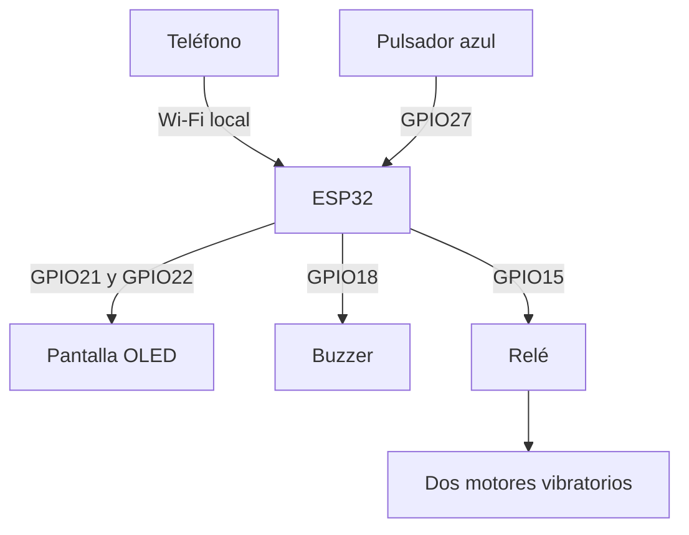

# Conexiones configuradas en el software

La siguiente tabla identifica los pines definidos en el firmware para controlar la alarma y la pantalla.

## Diagrama funcional

El diagrama representa la relación funcional entre los elementos de control y aviso.

## Pines

| Elemento | Pin del ESP32 | Función |
| --- | --- | --- |
| Buzzer | GPIO18 / D18 | Reproducción de tonos y melodías. |
| Entrada de control del relé | GPIO15 / D15 | Control de la salida asociada a los motores vibratorios. |
| Pulsador azul | GPIO27 / D27 | Detención de la alarma; el programa utiliza `INPUT_PULLUP` y un pulsador hacia GND. |
| Pantalla OLED: SDA | GPIO21 / D21 | Datos de la comunicación I²C. |
| Pantalla OLED: SCL | GPIO22 / D22 | Reloj de la comunicación I²C. |

El programa usa la configuración `U8G2_SH1106_128X64_NONAME_1_HW_I2C` y busca la pantalla en las direcciones I²C `0x3C` y `0x3D`. El relé controla la alimentación de los motores; el botón blanco se utiliza con el módulo de alimentación.

La tabla recoge las señales definidas en el firmware. Las fotografías del cableado se encuentran en [hardware/fotos](../fotos/README.md) y las características de los componentes en el [catálogo](../componentes.md).
