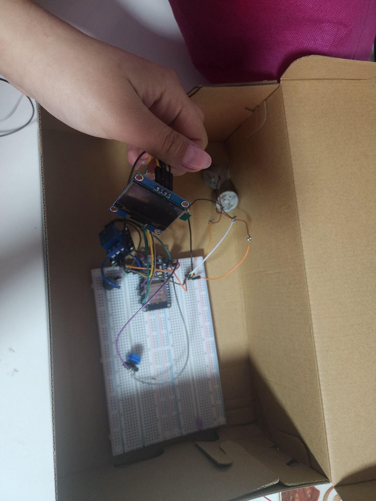
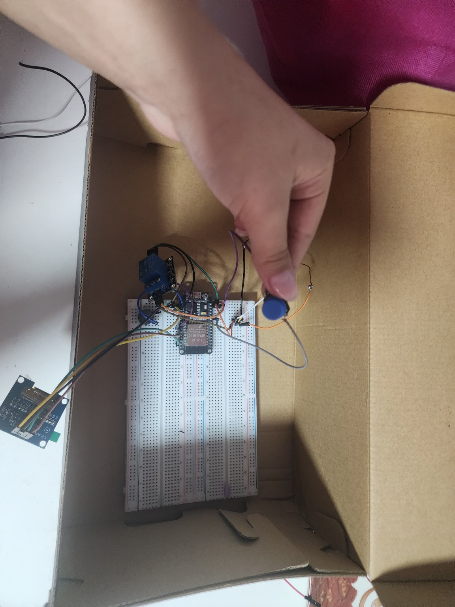
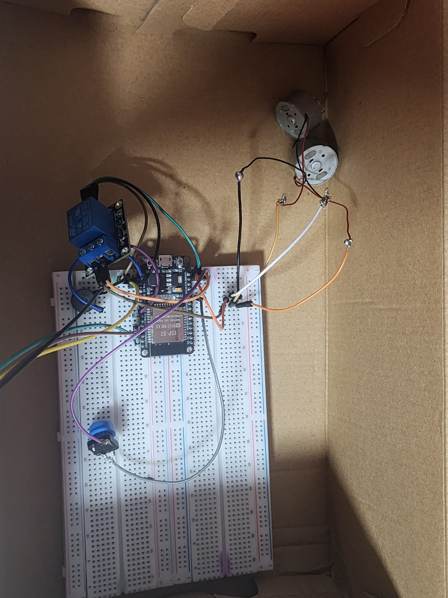
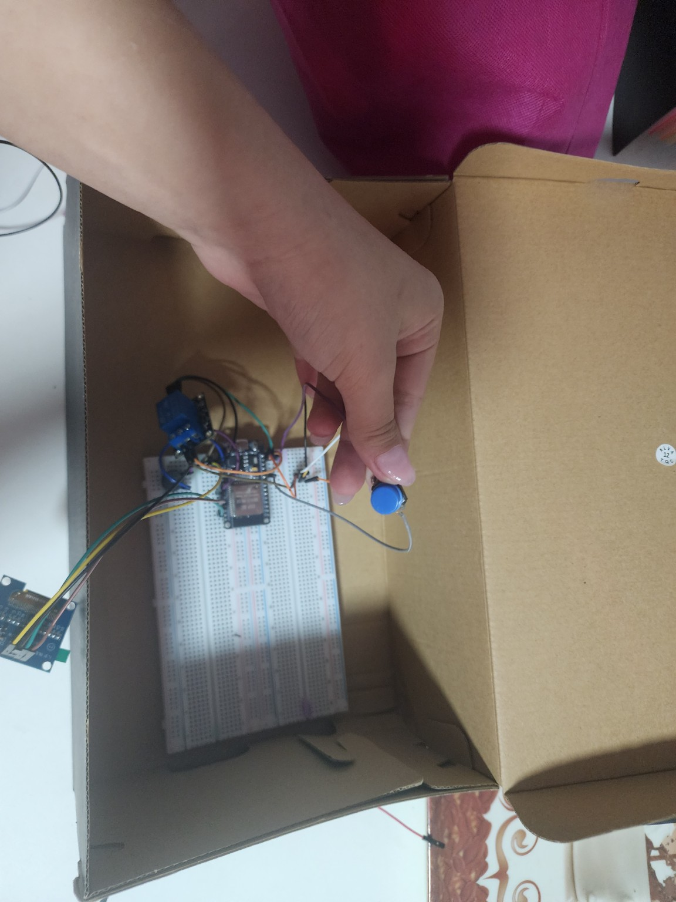
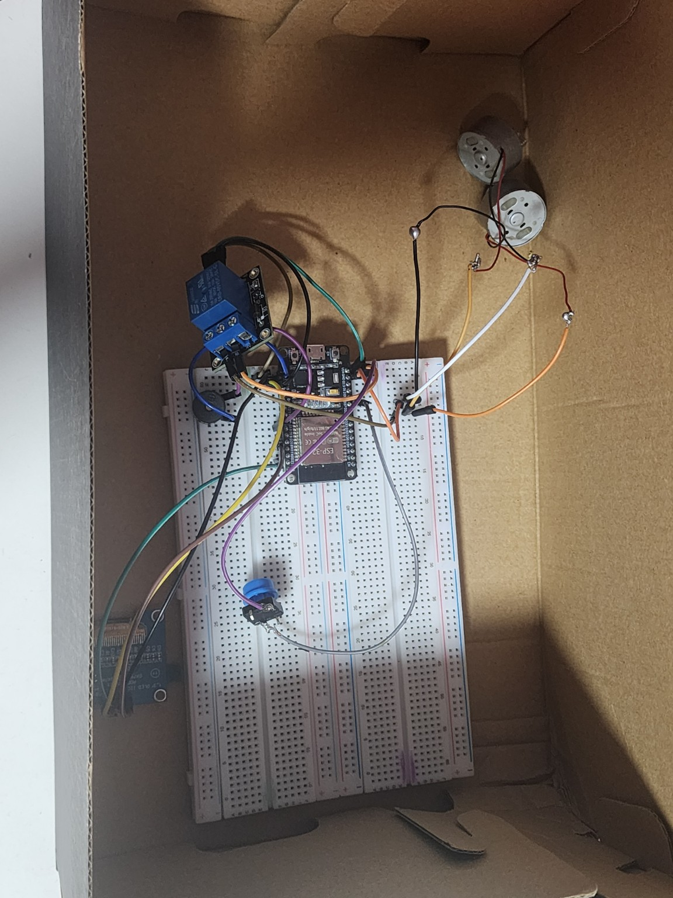
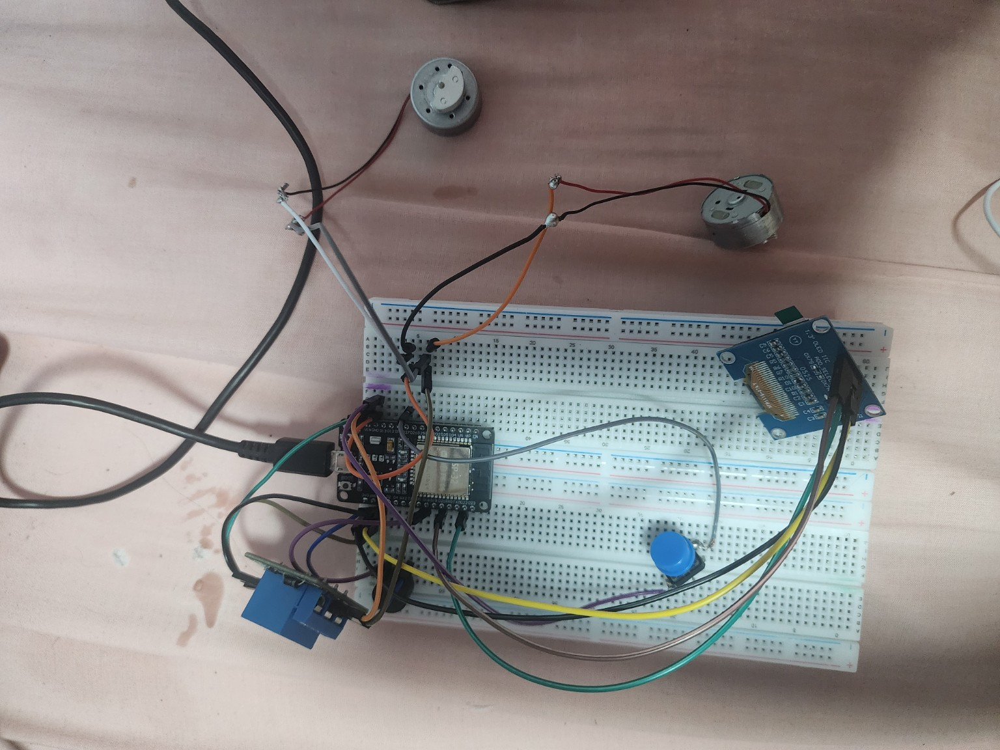
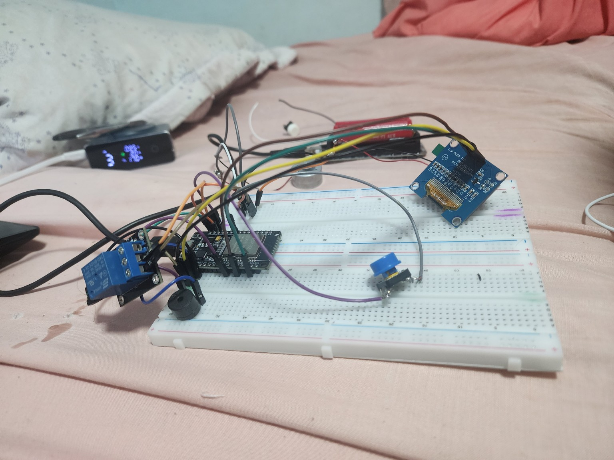
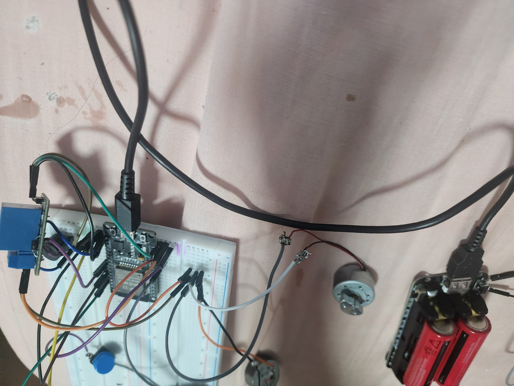
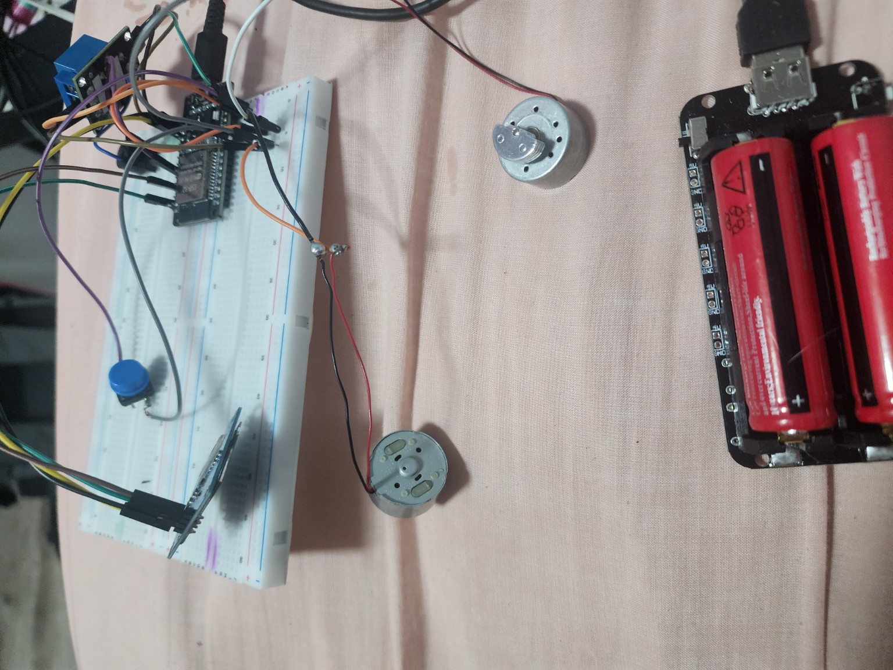
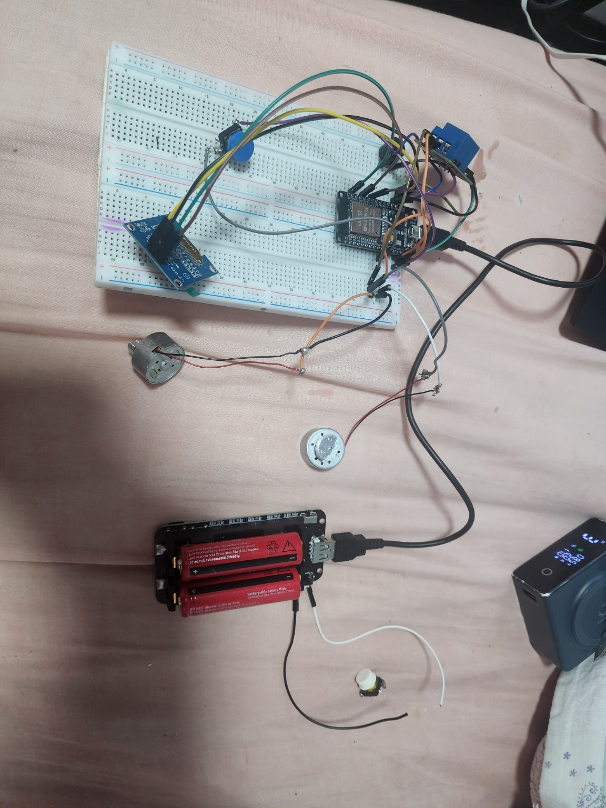

# Fotografías del montaje electrónico

Registro fotográfico del prototipo de alarma accesible con ESP32. Se presentan las fotografías reales del circuito y sus componentes durante las pruebas, antes de integrar la carcasa definitiva.

Las imágenes aparecen directamente, una debajo de otra, con un título y un pie de foto.

### 1. Vista interior de la caja y pantalla OLED

*Figura 1. La pantalla OLED se sostiene sobre la protoboard durante una prueba del montaje.*

### 2. Vista interior con pulsador azul

*Figura 2. Se muestra la ubicación del pulsador azul respecto al circuito instalado en la caja.*

### 3. Detalle del circuito dentro de la caja

*Figura 3. Vista cercana del ESP32, el relé, el buzzer, el cableado y los motores.*

### 4. Vista oblicua del pulsador azul

*Figura 4. Perspectiva del pulsador azul sostenido a un costado de la caja de pruebas.*

### 5. Vista superior del montaje en caja

*Figura 5. Distribución interna de la protoboard y de los motores de vibración.*

### 6. Vista superior de motores y componentes

*Figura 6. Montaje electrónico y ubicación conjunta de los dos motores.*

### 7. Perspectiva lateral de la protoboard

*Figura 7. Se observan el ESP32, el relé, el buzzer, la pantalla y el pulsador.*

### 8. Detalle de alimentación y motores

*Figura 8. Vista cercana de los motores y del módulo portabaterías con dos celdas.*

### 9. Protoboard, motores y portabaterías

*Figura 9. Se observa la relación espacial entre el circuito de control, los motores y la alimentación.*

### 10. Vista general de los componentes

*Figura 10. Distribución extendida de la protoboard, los dos motores, la pantalla y el módulo de alimentación.*

## Fotografías adicionales del montaje de pruebas

### 11. Vista general dentro de la caja

*Figura 11. Montaje electrónico en la caja de pruebas.*

### 12. Detalle de conexiones y componentes

*Figura 12. Detalle del cableado y los módulos.*

---

Estas fotografías documentan la etapa de pruebas con protoboard grande. La distribución definitiva prevista contempla dos protoboards compactas de 400 puntos y una carcasa ovalada. El esquema de conexiones eléctricas se documentará a partir de las conexiones verificadas, no solamente de los colores de cables observados en estas fotografías.
