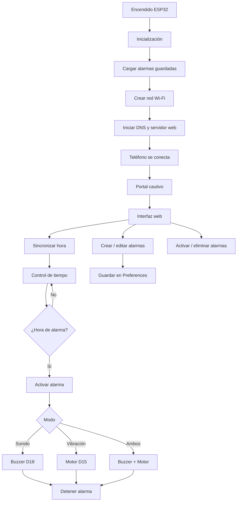

# Software - Documentación

## Contenido

Esta carpeta contiene el código fuente y la documentación del software correspondiente al sistema de alarma accesible desarrollado con ESP32.

El sistema permite configurar alarmas desde un teléfono mediante una interfaz web alojada directamente en el ESP32. Las alarmas pueden utilizar sonido, vibración o ambos métodos de aviso.

---

## 📁 Estructura de Carpetas

### `src/`

Contiene el código fuente principal del proyecto desarrollado para ESP32.

Archivo principal recomendado:

```text
src/pruebabuzzer_version_3_5.ino
```

La versión **3.5** corresponde a la versión funcional utilizada en el proyecto, incluyendo:

- Interfaz web de alarmas.
- Portal cautivo.
- Configuración de múltiples alarmas.
- Repetición por días.
- Alarmas para fechas específicas.
- Almacenamiento de alarmas en memoria.
- Buzzer con diferentes melodías.
- Motor vibrador sincronizado con el ritmo.
- Modos de sonido, vibración y sonido + vibración.

### `librerias/`

Carpeta destinada a librerías adicionales utilizadas por el proyecto.

Las principales librerías externas pueden instalarse directamente desde el administrador de librerías de Arduino IDE, por lo que no es obligatorio almacenarlas manualmente en esta carpeta.

### `docs/`

Contiene documentación técnica relacionada con:

- Arquitectura del software.
- Funcionamiento del portal cautivo.
- Conexiones del hardware.
- Funcionamiento de las alarmas.
- Pruebas realizadas.

---

# Stack Tecnológico

**Microcontrolador:** ESP32 DevKit V1  
**Plataforma:** Arduino / ESP32  
**Lenguaje:** C/C++  
**Interfaz:** HTML, CSS y JavaScript  
**IDE:** Arduino IDE 2.x  
**Comunicación:** Wi-Fi / HTTP  
**Almacenamiento:** Memoria interna del ESP32 mediante Preferences  

---

# Librerías principales

- **ESP32 Arduino Core (Espressif Systems)** - Versión **3.3.12**
- **AsyncTCP (ESP32Async)** - Versión **3.5.0**
- **ESPAsyncWebServer (ESP32Async)** - Versión **3.12.1**
- **WiFi.h** - Incluida en **ESP32 Core 3.3.12**
- **DNSServer.h** - Incluida en **ESP32 Core 3.3.12**
- **Preferences.h** - Incluida en **ESP32 Core 3.3.12**
- **esp_wifi.h** - Incluida en **ESP32 Core 3.3.12**
- **Arduino.h** - Incluida en **ESP32 Core 3.3.12**

---

# Función de las Librerías

### Arduino.h

Proporciona las funciones principales del entorno Arduino.

En el proyecto se utiliza para:

- Configurar pines.
- Controlar el motor vibrador.
- Controlar el buzzer.
- Utilizar temporizadores.
- Leer el tiempo mediante `millis()`.
- Utilizar comunicación Serial.

---

### WiFi.h

Permite utilizar el sistema Wi-Fi integrado del ESP32.

Se utiliza para crear una red Wi-Fi propia llamada:

```text
Alarma para sordos
```

El teléfono se conecta directamente a esta red, por lo que el sistema no necesita conectarse al router de una vivienda para funcionar.

---

### AsyncTCP.h

Proporciona la comunicación TCP asíncrona necesaria para el servidor web.

Permite que el ESP32 atienda solicitudes provenientes del teléfono sin detener otras funciones importantes, como:

- Comprobar las alarmas.
- Reproducir melodías.
- Activar el motor vibrador.

---

### ESPAsyncWebServer.h

Permite crear el servidor web alojado dentro del ESP32.

Se utiliza para:

- Mostrar la interfaz de alarmas.
- Crear alarmas.
- Editar alarmas.
- Eliminar alarmas.
- Activar o desactivar alarmas.
- Detener una alarma activa.
- Sincronizar la hora con el teléfono.

---

### DNSServer.h

Se utiliza para implementar el sistema de portal cautivo.

Cuando el usuario se conecta a la red Wi-Fi creada por el ESP32, las solicitudes DNS son redirigidas hacia la interfaz del sistema.

---

### esp_wifi.h

Permite realizar configuraciones de Wi-Fi de nivel más bajo que no están disponibles directamente mediante `WiFi.h`.

En este proyecto se utiliza como parte del funcionamiento especial del portal cautivo para mejorar su detección en dispositivos móviles.

---

### Preferences.h

Permite guardar información en la memoria no volátil del ESP32.

Gracias a esta librería, las alarmas configuradas pueden mantenerse almacenadas incluso después de reiniciar o desconectar el ESP32.

---

# Instalación y Configuración

## 1. Instalar Arduino IDE

Descargar e instalar **Arduino IDE 2.x** desde el sitio oficial de Arduino.

Después de la instalación, abrir Arduino IDE.

---

## 2. Instalar soporte para ESP32

Abrir:

```text
Tools → Board → Boards Manager
```

Buscar:

```text
ESP32
```

Instalar:

```text
ESP32 by Espressif Systems
```

Versión utilizada en el proyecto:

```text
3.3.12
```

---

## 3. Instalar Librerías Externas

Abrir:

```text
Tools → Manage Libraries
```

Instalar las siguientes librerías:

```text
AsyncTCP by ESP32Async
Versión 3.5.0
```

```text
ESP Async WebServer by ESP32Async
Versión 3.12.1
```

Las librerías:

```text
Arduino.h
WiFi.h
DNSServer.h
Preferences.h
esp_wifi.h
```

ya están incluidas con el paquete de ESP32.

---

## 4. Conectar el ESP32

Conectar el ESP32 al computador mediante cable Micro-USB.

En Arduino IDE seleccionar:

```text
Tools → Board → ESP32 Arduino → ESP32 Dev Module
```

Luego seleccionar el puerto correspondiente:

```text
Tools → Port
```

En el equipo utilizado durante el desarrollo, el ESP32 fue detectado mediante un puerto COM.

---

## 5. Abrir el Código

Abrir el archivo:

```text
src/pruebabuzzer_version_3_5.ino
```

---

## 6. Verificar el Código

Presionar el botón:

```text
✓ Verify
```

Arduino IDE compilará el programa y comprobará que no existan errores.

---

## 7. Subir el Código al ESP32

Una vez compilado correctamente, presionar:

```text
→ Upload
```

Esperar hasta que Arduino IDE muestre:

```text
Done uploading
```

El ESP32 reiniciará automáticamente y comenzará a ejecutar el sistema.

---

# Configuración Principal

Las principales configuraciones se encuentran al inicio del código.

## Red Wi-Fi

```cpp
const char* wifiNombre = "Alarma para sordos";
const char* wifiContrasena = "porfavor";
```

El ESP32 crea esta red automáticamente.

---

## Dirección del Portal

```cpp
const IPAddress ipLocal(4, 3, 2, 1);
const IPAddress ipGateway(4, 3, 2, 1);
```

La interfaz puede abrirse manualmente desde:

```text
http://4.3.2.1
```

si el portal cautivo no aparece automáticamente.

---

## Pines utilizados

```cpp
#define BUZZER 18
#define MOTOR_VIBRACION 15
```

### Buzzer

```text
Positivo (+) → D18
Negativo (-) → GND
```

### Motor Vibrador

```text
IN  → D15
VCC → Alimentación
GND → GND
```

---

# Modos de Alarma

Cada alarma puede configurarse utilizando uno de tres modos.

### Sonido

Activa solamente el buzzer.

```text
Buzzer → activo
Motor → apagado
```

### Vibración

Activa solamente el motor vibrador.

```text
Buzzer → apagado
Motor → activo
```

### Sonido + Vibración

Activa ambos sistemas simultáneamente.

```text
Buzzer → activo
Motor → activo
```

---

# Sonidos Disponibles

La versión 3.5 incluye los siguientes sonidos:

1. **Homecoming**
2. **Quantum Bell**
3. **Space Bell**
4. **Megalovania**
5. **Never Gonna Give You Up**
6. **Take On Me**

El buzzer reproduce las melodías mediante diferentes frecuencias.

El motor vibrador utiliza las mismas duraciones y pausas de las notas para generar un patrón de vibración relacionado con el ritmo de cada melodía.

---

# Funcionamiento de las Alarmas

El sistema permite configurar hasta:

```text
10 alarmas
```

Cada alarma contiene:

- Hora.
- Minuto.
- Sonido.
- Modo.
- Estado activado/desactivado.
- Tipo de repetición.
- Días seleccionados.
- Fecha específica, cuando corresponde.

---

# Tipos de Repetición

El sistema soporta cuatro configuraciones:

### Una vez

La alarma se ejecuta una sola vez.

### Todos los días

La alarma permanece activa diariamente.

### Elegir días

El usuario puede seleccionar días específicos como:

```text
Lunes
Martes
Miércoles
Jueves
Viernes
Sábado
Domingo
```

### Fecha específica

La alarma se activa únicamente en una fecha determinada.

---

# Sincronización de Hora

El ESP32 utilizado no incorpora un reloj RTC externo.

Por esta razón, al abrir la interfaz web, el teléfono envía su hora actual al ESP32.

El navegador utiliza:

```javascript
Date.now()
```

y el ESP32 utiliza posteriormente:

```cpp
millis()
```

para continuar contando el tiempo.

Después de reiniciar o desconectar completamente el ESP32, es necesario abrir nuevamente la interfaz para sincronizar la hora.

---

# Almacenamiento de Alarmas

Las alarmas se almacenan utilizando:

```cpp
Preferences
```

Esto permite conservar su configuración en la memoria interna del ESP32.

Los datos almacenados incluyen, entre otros:

```text
Hora
Minuto
Tono
Modo
Repetición
Días
Fecha
Estado
```

---

# Arquitectura del Software



---

# Módulos Principales

## 1. Inicialización

Configura:

- Buzzer.
- Motor.
- Memoria.
- Wi-Fi.
- DNS.
- Servidor web.
- Portal cautivo.

---

## 2. Gestión de Tiempo

Mantiene la hora sincronizada inicialmente desde el teléfono y posteriormente mediante `millis()`.

---

## 3. Gestión de Alarmas

Permite:

- Crear.
- Editar.
- Activar.
- Desactivar.
- Eliminar.
- Guardar alarmas.

---

## 4. Reproducción de Melodías

Utiliza el sistema LEDC del ESP32 para generar frecuencias mediante el buzzer.

La reproducción se realiza sin bloquear completamente el programa, permitiendo mantener operativa la interfaz web mientras suena una alarma.

---

## 5. Control de Vibración

El motor se controla mediante:

```cpp
digitalWrite()
```

La vibración sigue las duraciones y pausas utilizadas por las melodías.

---

## 6. Comunicación Web

El ESP32 funciona como servidor HTTP.

La interfaz está escrita directamente mediante:

```text
HTML
CSS
JavaScript
```

y se encuentra almacenada dentro del propio código del ESP32.

---

# API / Endpoints

La interfaz web se comunica con el ESP32 mediante los siguientes endpoints:

| Endpoint | Método | Descripción |
|---|---|---|
| `/api/sync-time` | POST | Sincroniza la hora del ESP32 con el teléfono |
| `/api/alarms` | GET | Obtiene todas las alarmas configuradas |
| `/api/save` | POST | Crea o modifica una alarma |
| `/api/toggle` | POST | Activa o desactiva una alarma |
| `/api/delete` | POST | Elimina una alarma |
| `/api/stop` | POST | Detiene la alarma que está sonando |
| `/api/status` | GET | Obtiene el estado actual del sistema |

---

# Portal Cautivo

Para facilitar el acceso desde teléfonos móviles, el proyecto incorpora un portal cautivo.

Se utilizan rutas compatibles con diferentes sistemas operativos, entre ellas:

```text
/generate_204
/gen_204
/hotspot-detect.html
/connecttest.txt
/ncsi.txt
/redirect
/canonical.html
/success.txt
/wpad.dat
```

Estas rutas permiten que diferentes teléfonos detecten la red como una red que requiere iniciar sesión y puedan mostrar automáticamente la interfaz.

---

# Flujo de Uso

1. Encender el ESP32.
2. Buscar redes Wi-Fi desde el teléfono.
3. Conectarse a:

```text
Alarma para sordos
```

4. Ingresar la contraseña configurada.
5. Esperar la apertura del portal cautivo.
6. Si no aparece automáticamente, abrir:

```text
http://4.3.2.1
```

7. La hora del teléfono se sincroniza con el ESP32.
8. Crear una alarma.
9. Seleccionar:
   - Hora.
   - Melodía.
   - Repetición.
   - Modo.
10. Guardar la alarma.
11. Al llegar la hora configurada, el ESP32 activa el sistema seleccionado.
12. La alarma puede detenerse desde el botón:

```text
Detener alarma
```

---

# Hardware Controlado por el Software

### ESP32 DevKit V1

Microcontrolador principal encargado de ejecutar toda la aplicación.

### Buzzer pasivo

Utilizado para reproducir las melodías mediante diferentes frecuencias.

### Motor vibrador PWM

Utilizado como sistema de aviso mediante vibración.

El módulo incluye su propia electrónica de control, permitiendo que el ESP32 utilice un pin digital únicamente como señal.

---

# Estado Actual

La **versión 3.5** utilizada en el proyecto implementa:

- ✅ Red Wi-Fi propia.
- ✅ Portal cautivo.
- ✅ Interfaz web.
- ✅ Sincronización de hora.
- ✅ Creación y edición de alarmas.
- ✅ Eliminación de alarmas.
- ✅ Activación/desactivación.
- ✅ Alarmas únicas.
- ✅ Alarmas diarias.
- ✅ Selección de días.
- ✅ Fecha específica.
- ✅ Memoria persistente.
- ✅ Buzzer.
- ✅ Motor vibrador.
- ✅ Sonido.
- ✅ Vibración.
- ✅ Sonido + vibración.
- ✅ Múltiples melodías.
- ✅ Botón para detener alarma.

---

# Versión

```text
Software: 3.5
Plataforma: ESP32
Estado: Funcional
```
