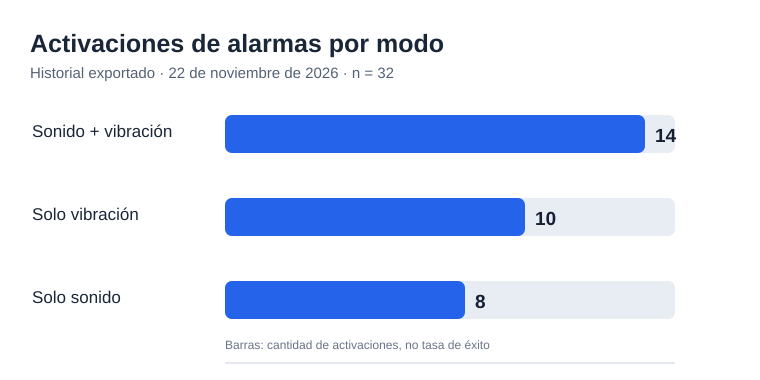

# Análisis del historial de alarmas — 22 de noviembre de 2026

El [historial CSV](historial_alarmas_2026-11-22.csv) fue exportado desde la página de la versión **4.1 revisiones**. Reúne 32 activaciones, con identificadores del 1 al 32, entre las 14:56 y las 17:00 del 22 de noviembre de 2026. El reloj del ESP32 se sincroniza al abrir la interfaz desde el teléfono.

## Resultados

| Indicador | Resultado |
| --- | ---: |
| Activaciones registradas | 32 |
| Detenciones registradas | 29 |
| Activaciones sin registro de cierre | 3 |
| Detenciones mediante botón físico | 19 |
| Detenciones desde la página web | 10 |
| Tiempo medio hasta la detención entre los 29 registros cerrados | 9,1 s |
| Mediana del tiempo hasta la detención | 7 s |
| Menor y mayor tiempo registrado hasta la detención | 1 s y 42 s |

### Activaciones por modo

| Modo | Activaciones | Con detención registrada | Sin cierre registrado |
| --- | ---: | ---: | ---: |
| Sonido y vibración | 14 | 13 | 1 |
| Solo vibración | 10 | 8 | 2 |
| Solo sonido | 8 | 8 | 0 |
| **Total** | **32** | **29** | **3** |

### Registros sin cierre

| ID | Activación | Modo |
| --- | --- | --- |
| 9 | 15:04 | Vibración |
| 10 | 15:05 | Sonido y vibración |
| 12 | 15:07 | Vibración |

Durante algunas pruebas se interrumpió la alimentación del dispositivo. Las tres entradas se mantienen como registros sin cierre, ya que el CSV muestra su estado y la causa específica de cada una requiere revisión adicional.

## Interpretación

El historial permite revisar cuándo se activó una alarma, el modo y melodía seleccionados y, en los registros cerrados, el origen y el tiempo transcurrido hasta la detención. Estas cifras sirven para revisar el uso de los controles y detectar entradas que requieren una revisión de continuidad del registro.

Los **9,1 segundos** corresponden al promedio del intervalo entre activación y detención registrada en 29 eventos. La percepción de vibración se documentó por separado con personas que sostenían los motores: ver [pruebas funcionales](../protocolo_pruebas.md).

## Funcionamiento del registro

El ESP32 guarda hasta 32 registros en memoria no volátil mediante `Preferences`. La página consulta los datos desde `/api/historial`, muestra la tabla y el gráfico por modo, y permite exportarlos en CSV. Cuando se alcanza el límite se conservan las activaciones más recientes.

El [script de resumen](resumir_historial.py) permite reproducir las cantidades y los tiempos a partir del CSV archivado.
